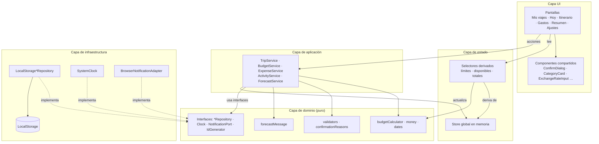
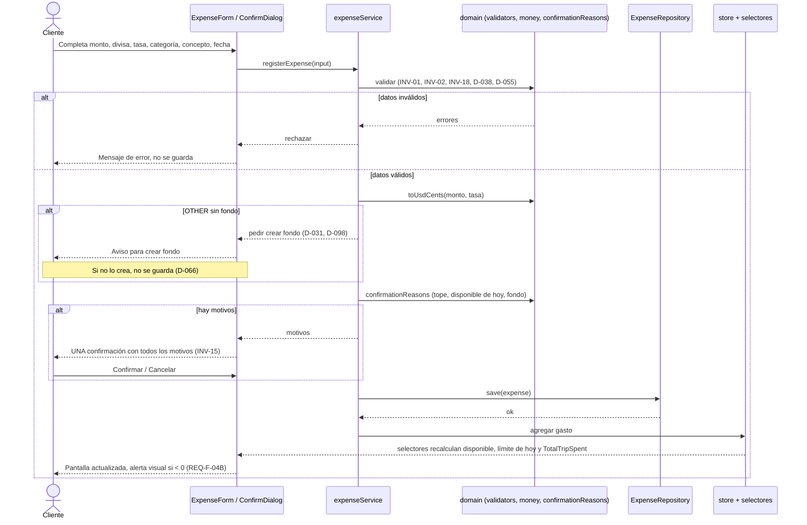
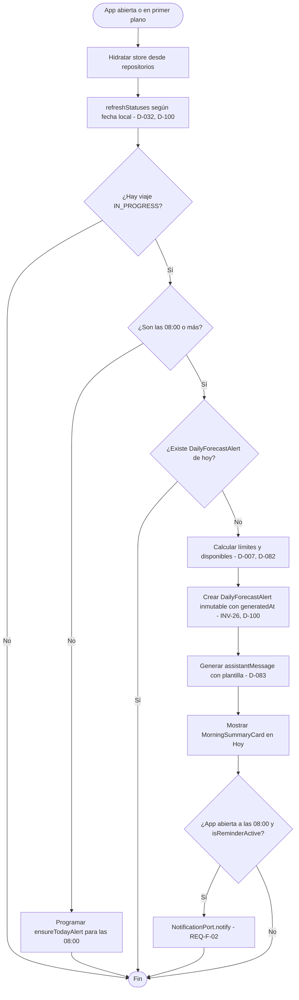
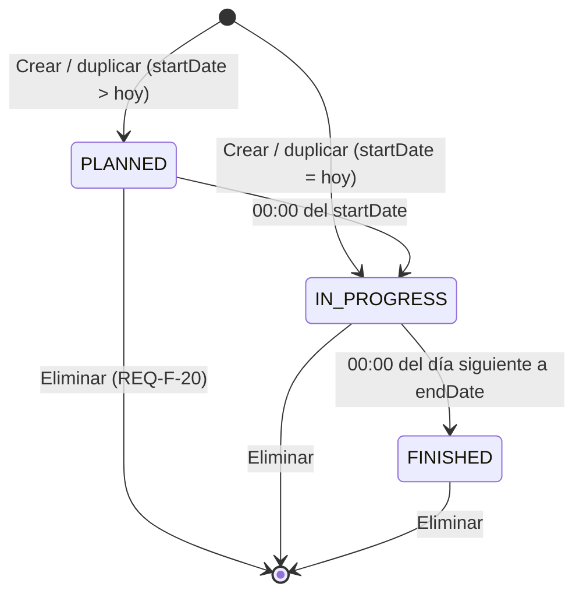
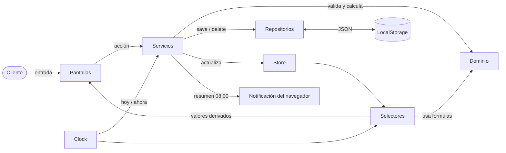

# Documento de Diseño — Asistente de Viajes

| | |
|---|---|
| **Versión** | 1.0 |
| **Fecha** | 2026-10-24 |
| **Fuentes** | `docs/requirements.md` · `docs/data-contract.json` · `docs/wireframe.md` y wireframe `[PDF §6–7]` · memoria semántica `CLAUDE.md` |

### Convenciones de este documento

- **[D-xxx]** marca la decisión registrada en `CLAUDE.md` §10 que respalda cada parte del diseño.
- Los identificadores de código van en inglés y los textos de la interfaz en español [D-019].
- Tecnología: **JavaScript sin framework de UI** (D-107, D-110). Los componentes de la §3 son módulos JavaScript que generan y actualizan el DOM.

---

## 1. Alcance y restricciones de diseño

| Restricción | Origen |
|---|---|
| Aplicación web de una sola página (SPA), **mobile-first y responsive** | D-060 |
| Persistencia **solo en LocalStorage**; un navegador corresponde a un cliente; sin backend ni autenticación | D-001, D-016 (requisito del curso) |
| **Sin servicios externos**: la tasa de cambio la ingresa el cliente | D-063 |
| **Sin inteligencia artificial**: el mensaje matutino usa una plantilla fija | D-033, D-083, D-114 |
| La lógica de dominio no accede directamente a LocalStorage; usa **repositorios** | D-018 |
| Cálculos en **USD, en centavos enteros**, con redondeo mitad hacia arriba | INV-05, D-051, D-053 |
| **Validación estricta**: se rechaza el dato inválido, nunca se corrige | D-002, INV-01, INV-02 |
| Sin notificaciones por gasto; las alertas son visuales | D-008 |
| El día cambia a las **00:00** (hora local); las **08:00** solo marcan el resumen | D-100 |

---

## 2. Arquitectura general

### 2.1 Capas [D-101]

La aplicación se organiza en cuatro capas. Cada capa solo depende de la que está debajo. La infraestructura implementa las interfaces que define el dominio, según el patrón repositorio [D-018].

| Capa | Responsabilidad | No debe |
|---|---|---|
| **UI** (pantallas y componentes) | Mostrar el estado, capturar la entrada y presentar confirmaciones y alertas | Calcular reglas de negocio ni acceder a LocalStorage |
| **Estado** (store + selectores) | Mantener en memoria los datos cargados y el estado de la UI, y exponer los valores derivados | Persistir valores derivados |
| **Aplicación** (servicios / casos de uso) | Orquestar cada flujo de `CLAUDE.md` §8: validar, construir confirmaciones, guardar y actualizar el store | Contener fórmulas, que viven en el dominio |
| **Dominio** (funciones puras) | Entidades, fórmulas, invariantes, validaciones y motivos de confirmación | Conocer el navegador, la fecha del sistema o LocalStorage |
| **Infraestructura** (adaptadores) | Repositorios sobre LocalStorage, reloj, notificaciones del navegador y generación de IDs | Contener reglas de negocio |



### 2.2 Puertos (interfaces del dominio) [D-101]

| Puerto | Operaciones | Implementación |
|---|---|---|
| `TripRepository` | `getAll`, `getById`, `save`, `delete` | `LocalStorageTripRepository` |
| `BudgetRepository` | `getByTripId`, `save`, `deleteByTripId` | `LocalStorageBudgetRepository` |
| `ExpenseRepository` | `getByTripId`, `save`, `delete`, `deleteByTripId` | `LocalStorageExpenseRepository` |
| `ActivityRepository` | `getByTripId`, `save`, `saveMany`, `delete`, `deleteByTripId` | `LocalStorageActivityRepository` |
| `ForecastAlertRepository` | `getByTripAndDate`, `getByTripId`, `create` (sin `update`, por INV-26), `deleteByTripId` | `LocalStorageForecastAlertRepository` |
| `Clock` | `now()`, `today()` en hora local | `SystemClock` |
| `NotificationPort` | `requestPermission()`, `notify(title, body)` | `BrowserNotificationAdapter` (Notification API) |
| `IdGenerator` | `newId()` (UUID) | Generador UUID del navegador |

`Clock` existe porque varias reglas dependen de "hoy": INV-28, D-032, D-055, D-065 y D-100. Centralizarlo evita que cada módulo lea la fecha del sistema por su cuenta.

---

## 3. Arquitectura de componentes de la interfaz

### 3.1 Correspondencia con el wireframe

El wireframe del PDF (§6) era un boceto de una sola pantalla. El contenido se separó en pantallas con un solo propósito cada una [D-061]. El boceto visual de 4 pantallas es solo referencia de estilo [D-005].

| Sección del wireframe `[PDF §6]` | Componente(s) en este diseño |
|---|---|
| Encabezado "Asistente de Viaje Personal" + `[Itinerario]` `[Resumen B]` | `TripShell` con navegación Hoy / Itinerario / Gastos / Resumen [D-061]. "Resumen B" era un ejemplo |
| Mi Viaje (Parámetros): presupuesto, lugar, país, fechas, preferencias | `TripCreateWizard` paso 1 y 2 · `SettingsScreen` → `TripDataForm`, `DatesForm`, `BudgetForm` |
| Recordatorio ON/OFF | `TripCreateWizard` paso 3 · `SettingsScreen` → `ReminderToggle` [D-023] |
| Itinerario (simulación por días: Día 1, Día 2…) | `ItineraryScreen` con `DayTabs` [D-088] |
| Presupuestos: alta prioridad (diario) y logística previa | `TodayScreen` (categorías diarias) · `SummaryScreen` (todas, incluidas Tiquetes y Hospedaje) · `BudgetForm` |

### 3.2 Árbol de componentes

```mermaid
flowchart TB
    APP["App"] --> ROUTER["Router"]
    ROUTER --> TL["TripListScreen<br/>(Mis viajes, §7.3)"]
    ROUTER --> WIZ["TripCreateWizard<br/>(3 pasos, flujo 8.2)"]
    ROUTER --> SHELL["TripShell<br/>(barra inferior en móvil / menú lateral en escritorio)"]

    TL --> TC["TripCard"]
    TL --> TM["TripActionsMenu<br/>Duplicar · Eliminar"]

    WIZ --> W1["StepTripData"]
    WIZ --> W2["StepBudget"]
    WIZ --> W3["StepReminder"]

    SHELL --> TODAY["TodayScreen (§7.2)"]
    SHELL --> ITI["ItineraryScreen (§7.4)"]
    SHELL --> EXP["ExpensesScreen (§7.5)"]
    SHELL --> SUM["SummaryScreen (§7.6)"]
    SHELL --> SET["SettingsScreen (§7.7)"]
    SHELL --> FAB["AddExpenseButton (+)"]

    TODAY --> MSC["MorningSummaryCard"]
    TODAY --> CC["CategoryCard ×3"]
    TODAY --> TAL["TodayActivitiesList"]

    ITI --> PBH["PlannedVsBudgetHeader"]
    ITI --> DT["DayTabs"]
    ITI --> AL["ActivityList"]
    ITI --> DET["CollapsibleSection<br/>'Fuera del viaje'"]

    EXP --> CHIPS["CategoryChips"]
    EXP --> EDG["ExpenseDayGroup"]

    SUM --> TOT["TripTotalHeader"]
    SUM --> CBR["CategoryBreakdown"]
    SUM --> RES["ReserveFundCard"]

    SET --> TDF["TripDataForm"]
    SET --> DF["DatesForm"]
    SET --> BF["BudgetForm"]
    SET --> RT["ReminderToggle"]

    FAB --> EF["ExpenseForm"]
    ITI --> AF["ActivityForm"]
```



### 3.3 Catálogo de pantallas

| Componente | Contenido | Estados del viaje | Referencia |
|---|---|---|---|
| `TripListScreen` | Viajes agrupados: En curso / Planificados / Finalizados. Botón "+ Nuevo". Menú ⋯ con Duplicar y Eliminar. Estado vacío | — | §7.3, D-085 |
| `TripCreateWizard` | Paso 1: Datos · Paso 2: Presupuesto (divisa, tasa, montos, topes) · Paso 3: Recordatorio | — | 8.2, D-070 |
| `TripShell` | Contenedor responsive. Abre en la pestaña inicial según el estado: `PLANNED` → Itinerario, `IN_PROGRESS` → Hoy, `FINISHED` → Resumen | Todos | §7.1, D-061 |
| `TodayScreen` | Resumen matutino, total disponible, una tarjeta por categoría diaria y las actividades de hoy. Variantes para `PLANNED` y `FINISHED` | Todos | §7.2, D-062 |
| `ItineraryScreen` | Planificado frente a presupuesto, pestañas por día, lista de actividades y sección "Fuera del viaje" | Todos | §7.4, D-088, D-089 |
| `ExpensesScreen` | Chips de categoría y gastos agrupados por día; cada gasto abre edición o eliminación | `IN_PROGRESS`, `FINISHED` | §7.5, D-090 |
| `SummaryScreen` | `TotalTripSpent` frente a lo planificado, desglose por categoría y fondo de imprevistos | Todos (en `PLANNED`, sin "Gastado") | §7.6, D-091 |
| `SettingsScreen` | Datos, Fechas, Presupuesto, Recordatorio, Duplicar y Eliminar | Todos (con bloqueos por estado) | §7.7, D-092 |

### 3.4 Componentes compartidos

| Componente | Responsabilidad | Referencia |
|---|---|---|
| `ConfirmDialog` | Muestra **un solo** aviso con **todos** los motivos de confirmación de la operación | INV-15 |
| `CategoryCard` | "Te quedan $X" (número principal) y "de $Y" (secundario), con barra de progreso. Si el valor es negativo, se muestra en rojo con alerta | D-062, REQ-F-04B |
| `OverBudgetAlert` | Indicador visual de sobrecosto reutilizable (tarjetas, resumen, itinerario) | REQ-F-04B, D-050 |
| `ExchangeRateInput` | Campo con formato explícito `1 USD = [ X ] {divisa}`, prellenado y editable. Se oculta si la divisa es USD | D-064, D-067, D-099 |
| `MoneyText` | Convierte centavos a "$1 234.50", siempre con 2 decimales | INV-25 |
| `DayTabs` | Pestañas Día 1…N. Abre en el día de hoy si el viaje está `IN_PROGRESS`; si no, en el Día 1 | D-088 |
| `CategoryChips` | Filtro Todos / Comida / Transporte / Actividades / Otros | D-090 |
| `CollapsibleSection` | Sección plegable, usada para "Fuera del viaje" | D-089 |
| `MorningSummaryCard` | Tarjeta cerrable con `assistantMessage` del día | REQ-F-02 |

### 3.5 Comportamiento responsive [D-060, D-061]

| | Celular (prioridad) | Computadora |
|---|---|---|
| Navegación de `TripShell` | Barra inferior: Hoy · Itinerario · Gastos · Resumen | Menú lateral con las mismas opciones |
| Registrar gasto | Botón flotante (+) | Botón "+ Gasto" en el menú lateral |
| Contenido | Una columna | Tarjetas en varias columnas |
| Pantallas y datos | Iguales | Iguales |

---

## 4. Estructura de módulos [D-102]

```text
index.html                      # punto de entrada; carga src/main.js como módulo ES (D-113)
src/
├── main.js                     # arranque: hidratación, eventos de tiempo (§5.2, §5.3)
├── domain/                     # Puro: sin navegador, sin LocalStorage, sin fecha del sistema
│   ├── types                   # Trip, GlobalBudget, Activity, Expense, DailyForecastAlert, enums
│   ├── money                   # centavos, redondeo ½↑, conversión (monto ÷ tasa)       INV-25, D-067
│   ├── dates                   # días totales, día relativo, rango, cruce de viajes      INV-04, INV-29
│   ├── budgetCalculator        # límites, disponibles, TotalTripSpent, fondo, USD        D-007, INV-20
│   ├── tripStatus              # estado según fechas                                     D-032, D-100
│   ├── validators              # reglas de validación estricta                           INV-01…INV-29
│   ├── confirmationReasons     # motivos de la confirmación única                        INV-15
│   ├── forecastMessage         # plantilla del resumen matutino                          D-083
│   └── ports                   # interfaces: repositorios, Clock, NotificationPort, IdGenerator
├── application/
│   ├── tripService             # crear, cambiar fechas, duplicar, eliminar, editar datos   8.2, 8.3, 8.9
│   ├── budgetService           # editar presupuesto                                      8.7
│   ├── expenseService          # registrar, editar, eliminar gasto                       8.1, 8.4, 8.5
│   ├── activityService         # gestionar actividades                                   8.6
│   └── forecastService         # resumen matutino                                        8.8
├── infrastructure/
│   ├── storage                 # adaptador LocalStorage: claves, serialización, versión   D-104
│   ├── repositories            # LocalStorage*Repository
│   ├── clock                   # SystemClock
│   └── notifications           # BrowserNotificationAdapter
├── state/
│   ├── store                   # estado global en memoria
│   └── selectors               # valores derivados (memoizados)
└── ui/
    ├── screens                 # una carpeta por pantalla (§3.3)
    └── components              # componentes compartidos (§3.4)
```

**Regla de dependencias:** `ui → state, application` · `application → domain` · `infrastructure → domain (ports)`. El dominio no importa nada de las demás capas.

---

## 5. Manejo de estado

### 5.1 Dónde vive cada dato [D-103]

| Tipo de dato | Dónde vive | ¿Persistido? | Ejemplos |
|---|---|---|---|
| **Entidades** | LocalStorage, como fuente de verdad, más una copia en el store | Sí | `Trip`, `GlobalBudget`, `Activity`, `Expense`, `DailyForecastAlert` |
| **Derivados del dominio** | Selectores calculados desde el store | **No** | `Daily{Cat}Limit`, `Daily{Cat}Remaining`, `TotalTripSpent`, equivalentes USD del presupuesto, `totalAmount` en USD, saldo del fondo, suma planificada de actividades [D-097, D-042, D-096] |
| **Estado global de UI** | Store | No | Viaje abierto, pestaña activa, filtro de categoría, resumen matutino cerrado hoy |
| **Estado local de UI** | Componente | No | Valores de formularios en edición, paso actual del wizard, diálogo abierto |

**Principio:** nunca se persiste un valor que se puede derivar. Así se evita que dos copias de un mismo dato se contradigan (por ejemplo, un límite guardado frente a uno recalculado), y se cumplen D-034, D-065 y D-097.

### 5.2 Ciclo de lectura y escritura

1. **Arranque (hidratación):** se leen las entidades desde los repositorios y se cargan en el store. Después se ejecutan `tripService.refreshStatuses()` [D-032, D-106] y `forecastService.ensureTodayAlert()` [REQ-F-02].
2. **Escritura:** la UI llama a un servicio. El servicio valida con el dominio y construye los motivos de confirmación. Si hay motivos, la UI muestra `ConfirmDialog`. Si el cliente confirma, el servicio guarda con el repositorio y actualiza el store. Los selectores se recalculan y la UI se vuelve a dibujar.
3. **Si falla la validación,** no se guarda nada y la UI muestra el mensaje de error [D-002].
4. **Si el cliente cancela la confirmación,** no se guarda nada [INV-15].

### 5.3 Eventos de tiempo [D-105]

| Evento | Acción | Referencia |
|---|---|---|
| La app se abre o vuelve a primer plano | `refreshStatuses()` y `ensureTodayAlert()` | D-032, REQ-F-02 |
| Medianoche (00:00 local) con la app abierta | Actualizar el "hoy" del store y `refreshStatuses()`. Los selectores recalculan los límites del nuevo día | D-100, INV-10 |
| 08:00 con la app abierta | `ensureTodayAlert()` con notificación del navegador si `isReminderActive` | REQ-F-02, D-035 |

### 5.4 Estructura en LocalStorage [D-104]

| Clave | Contenido |
|---|---|
| `travelAssistant:meta` | `{ "schemaVersion": 1 }` |
| `travelAssistant:trips` | Arreglo de `Trip` |
| `travelAssistant:budgets` | Arreglo de `GlobalBudget` |
| `travelAssistant:activities` | Arreglo de `Activity` |
| `travelAssistant:expenses` | Arreglo de `Expense` |
| `travelAssistant:forecastAlerts` | Arreglo de `DailyForecastAlert` |

- La serialización es JSON y la hace solo el adaptador `storage` [D-018].
- `schemaVersion` permite migrar los datos si el contrato cambia en el futuro.
- Si LocalStorage no está disponible o está lleno (~5 MB), el adaptador lanza un error controlado y la UI muestra un mensaje. Nunca se pierden datos en silencio.

---

## 6. Reglas de cálculo del dominio

Todas las fórmulas viven en `domain/` y se usan desde los selectores y los servicios. Ninguna pantalla calcula por su cuenta.

| Función | Fórmula / regla | Referencia |
|---|---|---|
| `toUsdCents(amount, rate)` | `round½↑(amount ÷ rate × 100)`; con USD, `rate = 1` | INV-25, D-067, D-099 |
| `totalDays(trip)` | `endDate − startDate + 1` | INV-04 |
| `dailyLimit(cat, today)` | `(Total cat USD − gastado en días anteriores a hoy) ÷ días restantes (incluido hoy)` | D-007, D-065, INV-10, INV-12 |
| `dailyRemaining(cat, today)` | `dailyLimit − gastos de la categoría con fecha = hoy` | D-007, INV-07 |
| `totalTripSpent(trip)` | `ticketsAmount + lodgingAmount + Σ Expense.amount` (nulos = 0) | INV-20 |
| `reserveRemaining(trip)` | `otherReserveAmount − Σ gastos OTHER` | INV-13 |
| `plannedActivitiesTotal(trip)` | `Σ estimatedCost` de actividades con `isDetached = false` | INV-24 |
| `statusFor(trip, today)` | `PLANNED` si hoy < inicio · `IN_PROGRESS` si inicio ≤ hoy ≤ fin · `FINISHED` si hoy > fin | D-032, D-100 |
| `overlaps(a, b)` | Los rangos de fechas se cruzan | INV-29 |
| `confirmationReasons(op)` | Lista de motivos: tope, disponible de hoy < 0, fondo < 0, categoría por debajo de lo gastado | INV-15 |

---

## 7. Diagramas de flujo de datos

### 7.1 Registrar gasto (flujo 8.1)



### 7.2 Arranque de la app y resumen matutino (flujo 8.8)



### 7.3 Ciclo de vida del viaje (D-032, D-100)



### 7.4 Flujo de datos entre capas (vista general)



---

## 8. Trazabilidad: requerimientos → diseño

### 8.1 Requerimientos funcionales EARS

| REQ | Resumen | UI | Aplicación | Dominio | Persistencia | Flujo / reglas |
|---|---|---|---|---|---|---|
| **REQ-F-01A** | Convertir a USD con la tasa ingresada por el cliente y calcular los días totales | `StepBudget`, `BudgetForm`, `ExchangeRateInput` | `tripService.create`, `budgetService.update` | `money.toUsdCents`, `dates.totalDays` | `BudgetRepository` guarda montos en divisa original + tasa (D-096) | 8.2, 8.7 · INV-04, INV-18, D-067 |
| **REQ-F-01B** | Límite diario por categoría = monto ÷ días totales | `StepBudget` (vista previa), `CategoryCard` | — | `budgetCalculator.dailyLimit` (caso día 1) | No se persiste (D-097) | INV-06, D-007 |
| **REQ-F-02** | Resumen matutino: notificación a las 08:00 si la app está abierta; si no, al abrirla | `MorningSummaryCard`, `ReminderToggle` | `forecastService.ensureTodayAlert` | `forecastMessage`, `budgetCalculator` | `ForecastAlertRepository.create` (inmutable) | 8.8 · D-034, D-035, D-082, D-083, INV-26 |
| **REQ-F-03** | Recalcular el disponible al registrar, editar o eliminar un gasto; los gastos pasados ajustan el límite de hoy | `ExpenseForm`, `TodayScreen`, `ExpensesScreen` | `expenseService.register/update/delete` | `dailyLimit`, `dailyRemaining`, `totalTripSpent` | `ExpenseRepository` | 8.1, 8.4, 8.5 · D-054, D-055, D-056, D-065 |
| **REQ-F-03B** | Rollover del sobrante o déficit a los días restantes | `TodayScreen` | — | `dailyLimit` (fórmula de D-007, bajo demanda) | No se persiste | INV-10, D-034, D-100 |
| **REQ-F-04A** | Permitir gastos que exceden el límite, con saldo negativo | `ConfirmDialog` | `expenseService.register` | `confirmationReasons` | `ExpenseRepository` | 8.1 · INV-08, INV-15 |
| **REQ-F-04B** | Alerta visual cuando un disponible es < 0 | `CategoryCard`, `OverBudgetAlert`, `CategoryBreakdown` | — | selectores `isOverBudget` | — | INV-09, D-008 |
| **REQ-F-05** | Bloquear inicio > fin | `StepTripData`, `DatesForm`, diálogo de duplicar | `tripService.create/changeDates/duplicate` | `validators.dateRange` | — | 8.2, 8.3 · INV-03, INV-28, INV-29 |
| **REQ-F-06** | Rechazar montos ≤ 0 | `StepBudget`, `BudgetForm`, `ExpenseForm` | servicios de presupuesto y gastos | `validators.positiveAmount` | — | INV-01, INV-17, D-006 (actividades: INV-22) |
| **REQ-F-13A** | Al acortar el viaje, desasociar las actividades fuera de rango y notificar | `DatesForm`, `ConfirmDialog` (listado), sección "Fuera del viaje" | `tripService.changeDates` | `dates.outOfRangeActivities` | `ActivityRepository.saveMany` (`isDetached = true`) | 8.3 · INV-11, D-089, D-094 |
| **REQ-F-13B** | Recalcular la cuota diaria tras cambiar la duración | `TodayScreen` | `tripService.changeDates` | `dailyLimit` con los nuevos días restantes | No se persiste | 8.3 · INV-12, D-065 |
| **REQ-F-18** | Gastos "Otros / Imprevistos" descuentan del fondo sin alterar las categorías diarias | `ExpenseForm`, `ReserveFundCard` | `expenseService.register` | `reserveRemaining` | `ExpenseRepository`, `BudgetRepository` (fondo) | 8.1 · INV-13, INV-19, D-031, D-098 |
| **REQ-F-19** | Duplicar viaje | `TripActionsMenu`, `SettingsScreen` | `tripService.duplicate` | `dates` (día relativo, cruce) | Todos los repositorios del viaje nuevo | D-057, D-058, D-059, D-095, D-096 |
| **REQ-F-20** | Eliminar viaje con todos sus datos | `TripActionsMenu`, `SettingsScreen`, `ConfirmDialog` | `tripService.delete` | — | `deleteByTripId` en los 5 repositorios | 8.9 · D-086, D-087 |

### 8.2 Capacidades del PDF (§3) sin formato EARS

| Capacidad `[PDF §3]` | Cómo se satisface |
|---|---|
| Edición en vivo sin alterar los históricos | Edición de gastos, actividades, fechas y presupuesto (flujos 8.3–8.7). Los `DailyForecastAlert` son inmutables [INV-26] |
| Parámetros reutilizables | LocalStorage [D-016] + "Duplicar viaje" [REQ-F-19] |
| Planificación anticipada | Estado `PLANNED`, `ItineraryScreen` con planificado frente a presupuesto [D-050] |
| Alarma / alerta diaria | REQ-F-02 · `forecastService` |
| Estandarización de moneda (USD) | `domain/money` [INV-05, INV-25] |

### 8.3 Reglas clave de `CLAUDE.md` que no son REQ

| Regla | Dónde se implementa |
|---|---|
| `ExpenseCap` y confirmación única [INV-14, INV-15] | `confirmationReasons` + `ConfirmDialog` |
| Sin viajes superpuestos [INV-29] | `validators` + `tripService.create/changeDates/duplicate` |
| Sin fechas pasadas al crear o duplicar [INV-28] | `validators` + `tripService` |
| Bloqueos por estado [D-071, D-073, D-081, D-098] | `tripService` / `budgetService`; la UI deshabilita los campos bloqueados |
| Botón (+) desactivado en `PLANNED` [D-066] | `AddExpenseButton` |
| Horas de actividad válidas, costo ≥ 0 [INV-21, INV-22] | `validators` + `activityService` |

---

## 9. Decisiones de arquitectura

| ID | Decisión | Motivo |
|---|---|---|
| **D-101** | Arquitectura en capas (UI, Estado, Aplicación, Dominio, Infraestructura) con puertos `Clock`, `NotificationPort` e `IdGenerator`, además de los repositorios | Extiende D-018: la lógica de fechas y montos se puede probar sin navegador |
| **D-102** | Estructura de módulos de la §4 | Ubica cada regla en un solo lugar |
| **D-103** | Store global en memoria con selectores derivados; LocalStorage como fuente de verdad; nunca persistir derivados | Evita copias contradictorias (D-034, D-065, D-097) |
| **D-104** | Una clave de LocalStorage por colección, prefijo `travelAssistant:` y `schemaVersion` | Cierra el PENDIENTE de `CLAUDE.md` §9 |
| **D-105** | Eventos de tiempo: al abrir o volver a primer plano, a las 00:00 y a las 08:00 | Implementa D-034 y D-100 sin backend |
| **D-106** | `Trip.status` se recalcula y guarda en cada arranque y a medianoche | El estado depende de la fecha (D-032), pero está en el contrato |

---

## 10. Pendientes

| ID | Pendiente | Afecta |
|---|---|---|
| ~~T-01~~ | **Resuelto:** JavaScript sin framework (D-107, D-110), sin herramienta de build, con módulos ES nativos y servidor local (D-113) | — |
| ~~T-02~~ | **Resuelto:** sin pruebas automatizadas; verificación manual (D-112) | — |
| ~~T-03~~ | **Resuelto:** `Activity.type` es texto libre opcional (D-111) | — |
| ~~T-04~~ | **Resuelto:** `docs/requirements.md` creado (D-108) | — |
